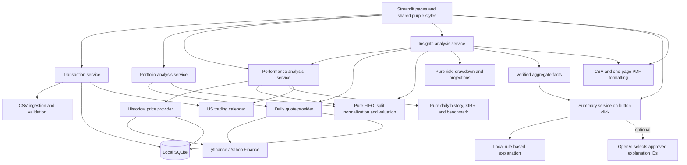

# Vamshi's Portfolio Lens

A local Streamlit app that brings transactions from Robinhood, Fidelity, Vanguard, and other brokers into one place.

**All four stages are implemented.** Add Transactions brings your broker records together; Current Portfolio answers “What do I own?”; Performance compares your return with the S&P 500; Insights explains concentration, historical drawdown, contribution scenarios, and downloadable summaries. All pages share the purple design system, and calculation code stays separate from Streamlit.

## Run the app

Open a terminal in this `portfolio-lens` folder, then run:

```bash
uv sync --locked
uv run streamlit run app.py
```

Open `http://localhost:8501` if your browser does not open automatically. Stop the app with `Ctrl+C`; saved transactions remain on disk. This project has its own Python environment and lockfile and does not use the neighboring coursework's environment. Python 3.12 is selected by `.python-version`. No API key is required to use the app, including its rule-based summary; fetching new market prices requires internet access.

### Optional AI summary setup

From this project folder, copy the template without replacing an existing file:

```bash
cp -n .env.example .env
```

Edit this project's `.env` and fill in `OPENAI_API_KEY`; `OPENAI_MODEL` defaults to `gpt-4.1-mini` and can be changed to an available model supporting Responses structured output. The app reads only this project's `.env`, and environment variables take precedence. It does not search neighboring coursework folders for keys. `.env` is ignored by this project's Git rules; `.env.example` contains no secret.

The optional request runs only when **Generate AI Summary** is clicked. It sends aggregate facts and approved explanations, never individual transactions, brokerage names, or import metadata. The model selects fact/explanation IDs; the app renders the verified text locally, so model-generated numbers are never accepted. The request uses `store=False`, a bounded timeout, and no automatic retries; this setting does not imply zero provider-side retention. Missing keys, API failures, refusals, or invalid selections use the local rule-based explanation. No key or paid API request is needed for tests.

## Click through Stage 1

1. Open **Add Transactions**, leave **Sample data** and **Append to saved transactions** selected, and click **Load Sample Data**.
2. Review 28 transactions and the warnings for the Sunday MSFT sale on **2026-04-19** (CSV row 27) and the Memorial Day TSLA sale on **2026-05-25** (row 29); both dates stay unchanged.
3. Click **Save transactions**. The import panel closes and the dashboard shows **28 transactions**, **$46,061.04 bought**, **$13,072.19 sold**, and **$32,988.85 net invested**. The charts show cash invested over time, monthly buys/sells, and transaction counts by broker.
4. Click **+ Add transactions**, then **Load Sample Data** again: the app flags 28 possible duplicates and defaults to **Skip duplicate rows**; saving again should leave 28 transactions.
5. Open **+ Add transactions** and choose **Manual entry**, enter a ticker, date, BUY or SELL, positive quantity, positive USD price, and broker, then click **Preview transaction** followed by **Save transactions**.
6. Test validation by entering `0` for quantity or `NaN` for price and previewing; the error identifies the field and saving is disabled.
7. Open **+ Add transactions** and choose **CSV upload**, select `transactions.csv` or your own file, choose its split convention, and click **Preview CSV** before saving.
8. To test replacement, select **Replace saved transactions**, preview the sample, then check **Replace all ... saved transaction(s) with this batch** before saving; this intentionally replaces your current transaction history.
9. Filter the transactions table by ticker, broker, BUY/SELL, or date range. Click column headings to sort; use the row-count selector and arrows to page through results. The charts and KPIs continue to show all saved transactions.
10. Stop and restart the app, or open a new browser session, to confirm saved transactions are still present and import controls start collapsed.

The buttons prepare a preview first; they do not write transactions until **Save transactions** is clicked. **Discard preview** leaves saved data unchanged.

## Click through Stage 2

1. Load and save the sample as described above, then click **Current Portfolio** in the sidebar.
2. Check the five KPI cards and their explanations; the sample's FIFO realized gain is **$1,298.22**, and remaining cost basis is **$34,287.07**, independent of current market prices.
3. Check the holdings: **AAPL 10, JNJ 15, JPM 12, MSFT 9, NVDA 80, TSLA 4, VOO 23**.
4. Change **Broker** to **Fidelity**; the whole page now covers that broker, including **25 NVDA**, **15 JNJ**, and **9 MSFT** shares.
5. Switch **Allocation view** between **By Stock**, **By Sector**, and **By Broker**; VOO is labeled ETF, and missing sectors remain Unknown.
6. Open **Adjust concentration thresholds**, change either limit, and see the badge respond; defaults are 25% for a single holding and 60% for the top three.
7. Check the visible price timestamp and click **Refresh prices** to request a new snapshot; on a failed request, good cached prices remain visible with a warning.
8. Return to **Add Transactions**, enter a sale larger than the shares held at that broker, and preview it; saving is blocked with a holdings error.
9. Inspect the non-trading-date notices on both pages; the Sunday MSFT trade remains dated April 19.

The five cards use complete, comparable prices or display Unavailable; absent prices never become zero. Price-dependent figures vary with the market. The broker filter affects every portfolio figure, while the Add Transactions history filters affect only that table.

## Click through Stage 3

1. Load and save the sample, then click **Performance** in the sidebar; the first historical download may take a little longer.
2. Check the five cards and explanations: **Total invested $46,061.04** and **Total sold $13,072.19** are fixed for the unchanged sample; Current value, XIRR, and Total return depend on available prices.
3. Read the green/amber comparison banner and the common **as of** date; if prices or a valid return are unavailable, read the reason instead of a verdict.
4. Try **1M**, **6M**, **1Y**, and **All**, and toggle **Show S&P 500 benchmark**; only the main chart changes, while the cards always cover all saved trades.
5. Hover the green BUY and red SELL markers to see the ticker, trade amount, original recorded date, and chart date.
6. Find the notices mapping **MSFT 2026-04-19 → 2026-04-20** and **TSLA 2026-05-25 → 2026-05-26**; return to Add Transactions to verify their recorded dates are unchanged.
7. Compare the realized and unrealized bars per ticker, then open **Assumptions** for the definitions and benchmark method.
8. Click **Refresh history** to retry unavailable data; a failed download preserves previously cached points with a visible warning, and missing closes stay gaps.

### Performance conventions and limits

- **XIRR** is the annual, money-weighted rate balancing negative purchases, positive sales, and a final positive holdings value, using original transaction dates and actual days divided by 365. Both portfolio and benchmark use identical cash-flow dates. No number is shown for missing terminal values, no valid root, multiple roots, or numerically unreliable results; short histories can produce very large annualized rates.
- **Total return** is `(current value + total sold − total invested) / total invested`; the accompanying dollar gain is the numerator. This is a simple lifetime gain, not an annualized or time-weighted return.
- **Matched benchmark** means buying fractional `^GSPC` units with each purchase amount and withdrawing each sale amount at the effective session's closing price. It is a hypothetical price-index simulation, not an investable fund. An infeasible withdrawal stops subsequent benchmark values and disables the verdict; the app never borrows units to force the comparison.
- **Chart dates** use the next US trading session for weekend/holiday trades, while stored rows and XIRR dates remain unchanged. Cards use all saved trades; chart ranges do not change the calculation period. Trades after the latest completed session remain pending and disable lifetime terminal values rather than being silently discarded.
- **Price basis and exclusions:** daily Close prices are split-adjusted but not dividend-adjusted; dividends, fees, taxes, cash balances, deposits, and account transfers are excluded. Trades are modeled as contributions/withdrawals at their stated dollar amounts. The value chart therefore includes contribution effects.
- **Incomplete history** creates gaps, never invented zero or forward-filled prices. A valid terminal value can still support the portfolio's XIRR despite earlier gaps, but the comparison verdict requires complete histories. Fully sold positions have a genuine zero ending value and retain realized gains.
- **Historical cache** persists independently of quote snapshots in the same local database, with a complete replacement of each ticker's price and split series on refresh. Intraday split actions can be used without treating an unfinished daily Close as final. Explicitly non-USD histories are rejected.
- **Numerical limits:** the XIRR solver checks for uniqueness rather than selecting a convenient root. Very long histories with many alternating purchase/sale dates or poorly conditioned cash flows can return an explanatory unavailable result.

## Click through Stage 4

1. Load and save the sample, then open **Insights**. Check its completed-market-close date and any cached or incomplete-data notices.
2. Review the amber concentration cards; each gives its observed percentage and configured limit, and single holdings include the number of brokers holding them. Live prices determine which sample alerts appear; automated tests fix NVDA at **36% across two brokers** to verify the default rule reliably.
3. Open **Adjust risk thresholds** and change the holding, top-three, and sector sliders. Defaults are **25% / 60% / 50%**; only values strictly above a limit trigger alerts. Set all limits to 100% to check the no-breach state, then restore defaults. Unknown sectors and ETF exposure remain disclosed.
4. Read **Max drawdown** and hover its small chart. This is the largest historical fall after accounting for purchase and sale cash flows, not a fall in raw account dollars after withdrawing money.
5. Move **Monthly contribution ($)** from 0 to 2,000 and **Years** from 1 to 30; inspect the lower, base, and higher scenarios, rates, historical estimation dates, and contribution totals. These are illustrations, not forecasts or probability bounds.
6. Read the built-in plain-English explanation. Click **Generate AI Summary** without a key to verify the local fallback; with a configured key, it requests an AI-assisted selection of the verified explanations. Open **What can be shared with AI?** to inspect the aggregate catalog.
7. Change a slider after generating a summary; the previous summary is invalidated, and a current local explanation is shown until you generate again.
8. Download **holdings CSV**, **transactions CSV**, and **summary PDF**. The transaction export has the six original columns and retains the Sunday MSFT date; holdings include a price timestamp and missing-data status; the PDF is one page and reflects the selected contribution settings.
9. Open **Insights assumptions** for the cash-flow timing convention and limitations. **Refresh insights** retries price history and sector metadata; failed downloads preserve available cached data with notices.

### Insights calculation conventions

- **Concentration:** percentages use total priced portfolio value; holdings are consolidated across brokers, and broker counts include only accounts with positive remaining shares. An alert is a product threshold breach, not an instruction to trade. Sector checks use known stock sectors; ETFs and unknown sectors stay outside sector coverage, without redistributing their weight to known sectors.
- **Flow-adjusted history:** the daily return approximation is `(end value − start value − net contributions) / (start value + 0.5 × net contributions)`. Purchases are positive contributions and sales are negative contributions under the transaction-only model. The midpoint assumption compensates for the absence of intraday trade times; this is not an exact time-weighted return or a claim of GIPS compliance.
- **Drawdown:** link those daily returns into an index beginning at the first positive completed valuation, then measure its largest percentage decline from a previous peak. The first valuation is the starting point, so its execution-day change is excluded. Missing prices or invalid adjusted capital make the full-period result unavailable. After liquidation, empty zero-value/no-flow sessions carry the index but do not add return observations.
- **Annual estimates:** at least 30 observed daily-return intervals are required; geometric growth uses 252 trading sessions per year, and volatility is the sample standard deviation of daily returns multiplied by the square root of 252. These describe the observed invested intervals, excluding empty sessions.
- **What-if illustration:** the base rate is historical flow-adjusted annual growth, while the lower/higher rates move annual log-growth down/up by annualized daily volatility. The selected amount is added at each month-end. The displayed historical dates and rates remain explicit; insufficient history, a missing starting value, or unstable arithmetic disables the scenarios.
- **Consistent prices:** Insights values holdings and starting balances with the Performance history's completed-session closes and split basis; the quote provider supplies sector metadata only. Raw trade quantities are withheld if verified split coverage cannot be obtained.

## Portfolio calculation conventions

- **FIFO:** first in, first out, so sales consume the oldest purchase lots within the same ticker and broker; this is an app convention, not tax advice.
- **Cost basis:** the purchase cost of shares still held; **average cost** divides that amount by remaining shares.
- **Realized gain/loss:** proceeds from sold shares minus their FIFO cost, including investments that have been fully sold.
- **Unrealized gain/loss:** current holdings value minus remaining cost basis; its percentage divides that difference by cost basis.
- **Today's change:** the latest completed trading session's price change multiplied by the shares currently held, with the session date shown; it is not an intraday account return and does not reconstruct that day's trades.
- **Concentration:** Low when neither configured threshold is exceeded, Moderate when one is exceeded, and High when both are exceeded; this is a concentration indicator, not an overall investment-risk assessment.
- **Dividends and fees are excluded.** Closing prices are not dividend-adjusted; split normalization uses copies of raw trades and never changes stored rows.
- **Market data:** yfinance closing prices and metadata are cached in SQLite and refreshed for each newly completed US session; Refresh prices bypasses the daily cache. Failed requests use the last valid quote with its original timestamp and a warning. Quotes from different sessions cannot produce complete totals or weights.
- **Raw splits:** original trade quantities are converted to the current share basis using verified split history, including splits effective today before market close; if coverage is incomplete, calculations are withheld rather than guessed. Already-adjusted imports must already use a consistent share basis.
- **Calendars:** the NYSE US equity schedule includes holidays and early closes, with configured coverage from 1990 through 2100; unsupported raw-history dates produce an explanatory notice. Calendar warnings never rewrite trade dates.
- **Same-day order:** because the CSV has no trade time, existing saved order followed by incoming row order determines the order of trades on the same date.

## Accepted input and validation

CSV files must have exactly these six columns, in any order:

```csv
ticker,date,transaction_type,quantity,price,broker
AAPL,2026-01-02,BUY,2,195.58,Fidelity
```

- Header casing and surrounding spaces are normalized; ticker and transaction type become uppercase.
- Dates must use `YYYY-MM-DD` and cannot be in the future relative to America/Los_Angeles.
- Quantities and prices must be finite positive numbers, with up to 12 decimal places and a maximum of one trillion.
- A broker name is required; the three sample broker names are normalized, and other names are accepted.
- UTF-8 CSVs, including Excel's UTF-8 BOM, are accepted up to 5 MB and 10,000 transaction rows.
- Errors block the entire batch, so a partially valid file never creates a partial import.
- Weekends and US equity-market holidays produce warnings only; dates remain unchanged.
- Duplicate detection compares all six normalized values, including the broker, and flags matches both within a batch and against saved data when appending.
- Duplicate candidates are skipped by default; choose **Keep all rows (including duplicates)** for intentionally identical trades.
- Replacement compares duplicates within the incoming file and requires confirmation in the UI.
- Overselling is checked after applying append/replace and duplicate choices to the whole resulting history, separately for each ticker and broker; commit checks it again and protects against stale previews.

The sample is copied unchanged and recorded as already split-adjusted. Other imports declare either already-adjusted or original trade values; split adjustments occur only in calculation copies. Prices are assumed to be USD, and explicitly non-USD market quotes are rejected. The Insights page supplies optional summaries and local exports.

## Final architecture

The interface calls the transaction service, which parses input, validates it, and uses SQLite storage. The input and storage modules do not import Streamlit. Numerical input uses `Decimal`, and SQLite stores those values as text so fractional shares and prices are preserved exactly. A save is one database transaction: either the entire change succeeds or the existing history remains intact. If another session changes the database after a preview, the app asks you to preview again before saving.

Performance follows the same separation: the UI asks the performance service for results; the service combines calendar dates, cached historical prices, and pure calculation modules. The calculations receive data as arguments and never call Streamlit, SQLite, or Yahoo Finance.

Insights reuses Performance history and FIFO valuation, adds pure risk/drawdown/projection results, and builds a catalog of verified aggregate facts. Its summary service either renders locally or asks the optional API to select approved explanations; exports format the supplied results without calculating financial metrics. UI session state holds sliders and generated explanations, while SQLite holds durable transactions and market caches.



| File | One-sentence explanation |
| --- | --- |
| `pyproject.toml` | Lists the project details, application dependencies, development tools, and package settings. |
| `uv.lock` | Records the exact dependency versions so another computer can install the same environment. |
| `.python-version` | Tells uv to use Python 3.12 for this project. |
| `.gitignore` | Keeps local data, secrets, virtual environments, and generated files out of version control. |
| `.env.example` | Shows the optional AI API key and model settings without including a real secret. |
| `.env` (optional, user-created) | Stores this project's optional AI settings locally and stays outside version control. |
| `.streamlit/config.toml` | Defines the calm light theme, local server address, upload limit, and disabled usage telemetry. |
| `README.md` | Explains how to run, test, and understand this project. |
| `transactions.csv` | Provides the unchanged default sample used by the Load Sample Data button. |
| `app.py` | Launches the UI entry point; presentation stays inside the UI package. |
| `src/portfolio_lens/__init__.py` | Marks the application code as an importable Python package. |
| `src/portfolio_lens/config.py` | Locates the sample and database and supplies today's date in the user's timezone. |
| `src/portfolio_lens/models.py` | Defines shared transactions, validation results, market quotes, and stock-split events. |
| `src/portfolio_lens/ingestion.py` | Reads CSV input while retaining row numbers for useful error messages. |
| `src/portfolio_lens/validation.py` | Checks transaction fields and identifies non-trading dates and possible duplicates. |
| `src/portfolio_lens/storage.py` | Saves and loads transaction history and import details using atomic SQLite operations. |
| `src/portfolio_lens/services/__init__.py` | Marks the service layer as an importable Python package. |
| `src/portfolio_lens/services/transactions.py` | Coordinates previews, validation, duplicate decisions, and safe saves without drawing the interface. |
| `src/portfolio_lens/services/analysis.py` | Combines stored trades, market information, and calculations into one portfolio snapshot. |
| `src/portfolio_lens/services/performance.py` | Combines historical prices, original cash-flow dates, trading sessions, and pure calculations into comparable performance results. |
| `src/portfolio_lens/services/insights.py` | Combines matching price histories, concentration, drawdown, projections, and verified aggregate facts for the Insights screen and report. |
| `src/portfolio_lens/services/summary.py` | Renders verified explanations locally or requests a bounded AI selection of approved facts and explanations. |
| `src/portfolio_lens/exports.py` | Formats original transactions, calculated holdings, and supplied summary facts into CSV files and a one-page PDF. |
| `src/portfolio_lens/trading_calendar.py` | Identifies US equity trading days and actual closing times, including holidays and early closes. |
| `src/portfolio_lens/market_data.py` | Fetches yfinance prices and split events while keeping a durable daily cache and reporting unavailable data. |
| `src/portfolio_lens/historical_market_data.py` | Downloads and caches complete historical price and split series while preserving gaps and warning when cached data is reused. |
| `src/portfolio_lens/calculations/__init__.py` | Groups calculation modules that do not depend on Streamlit. |
| `src/portfolio_lens/calculations/corporate_actions.py` | Converts copies of original trades to a consistent split-adjusted share basis. |
| `src/portfolio_lens/calculations/accounting.py` | Replays broker-specific FIFO purchases and sales into holdings, cost basis, realized gains, and overselling errors. |
| `src/portfolio_lens/calculations/valuation.py` | Combines holdings and supplied quotes into portfolio values, unrealized gains, allocation, and concentration. |
| `src/portfolio_lens/calculations/history.py` | Replays supplied trades across trading sessions to produce daily holdings values and buy/sell markers without fetching data. |
| `src/portfolio_lens/calculations/performance.py` | Calculates exact cash totals, simple total return, and a unique annual money-weighted return or an explanation of why it is unavailable. |
| `src/portfolio_lens/calculations/benchmark.py` | Simulates investing and withdrawing the same dollar amounts in an index and flags withdrawals the simulated holdings cannot fund. |
| `src/portfolio_lens/calculations/risk.py` | Checks configured concentration limits against combined holdings and reports broker counts and sector coverage. |
| `src/portfolio_lens/calculations/drawdown.py` | Adjusts historical returns for cash flows and calculates drawdown, annual growth, and return variability when data is sufficient. |
| `src/portfolio_lens/calculations/projections.py` | Calculates three illustrative contribution paths from supplied historical rate and variability estimates. |
| `src/portfolio_lens/ui/__init__.py` | Groups the Streamlit interface modules into a Python package. |
| `src/portfolio_lens/ui/components.py` | Displays preview tables and validation messages. |
| `src/portfolio_lens/ui/add_transactions.py` | Draws the sample, upload, manual-entry, preview, and saved-history controls. |
| `src/portfolio_lens/ui/current_portfolio.py` | Presents portfolio cards, allocation, broker filters, concentration controls, and the holdings table in the purple design. |
| `src/portfolio_lens/ui/performance.py` | Displays return cards, the benchmark verdict, historical charts, date notices, and assumptions using the shared purple design. |
| `src/portfolio_lens/ui/insights.py` | Presents risk cards, drawdown, scenario sliders, verified explanations, and download buttons in the shared purple design. |
| `src/portfolio_lens/transaction_summary.py` | Adds exact trade values and calculates read-only dashboard summaries without Streamlit. |
| `src/portfolio_lens/ui/shell.py` | Draws sidebar navigation, import metadata, and error states for all four completed pages. |
| `src/portfolio_lens/ui/styles.py` / `styles.css` | Share the purple palette, chart colors, card styling, and responsive layout rules. |
| `src/portfolio_lens/ui/dashboard.py` | Presents four KPIs and three Plotly charts using transaction summaries. |
| `src/portfolio_lens/ui/history.py` / `table.html` | Present filters, sortable/paginated rows, trade badges, broker tags, and non-trading-date tooltips. |
| `tests/test_transaction_summary.py` | Checks empty data, exact decimals, cash-flow aggregation, missing months, and broker counts. |
| `tests/test_ingestion.py` | Checks CSV parsing, transaction validation, and preservation of the deliberate Sunday trade. |
| `tests/test_storage.py` | Checks persistence, duplicate handling, replacement safety, and stale-preview protection. |
| `tests/test_app.py` | Exercises the Streamlit screens with a temporary database to verify the main user flows. |
| `tests/test_accounting.py` | Checks FIFO sales, broker separation, split adjustments, and the sample's expected remaining shares. |
| `tests/test_valuation.py` | Checks price-based values, missing-data handling, allocation, broker filters, and concentration boundaries. |
| `tests/test_market_data.py` | Checks persistent quote caching, provider failures, sector fallback, and split-history coverage using controlled market responses. |
| `tests/test_trading_calendar.py` | Checks holiday warnings, completed sessions, timezone rules, and early closes. |
| `tests/test_portfolio_validation.py` | Checks overselling against the resulting import history, including duplicates, broker separation, and raw stock splits. |
| `tests/test_current_portfolio.py` | Checks the portfolio screen, consolidated holdings, broker filtering, and missing or cached price notices. |
| `tests/test_history.py` | Checks daily holdings values, original-date preservation, trade markers, broker overselling, and missing-price gaps. |
| `tests/test_performance.py` | Checks known XIRR examples, ambiguous or invalid rates, original cash amounts, and lifetime return totals. |
| `tests/test_benchmark.py` | Checks matched index cash flows, exact fractional units, date mapping, missing prices, and infeasible sales. |
| `tests/test_historical_market_data.py` | Checks daily historical caching, stale fallbacks, split coverage, currency rejection, and completed-session prices with controlled provider responses. |
| `tests/test_performance_service.py` | Checks that original transactions, historical prices, date mapping, and FIFO gains combine into safe comparison results. |
| `tests/test_performance_ui.py` | Exercises the Performance cards, chart controls, trade markers, benchmark verdict, and incomplete-data notices. |
| `tests/test_risk.py` | Checks NVDA and other concentration breaches, strict threshold boundaries, broker consolidation, and incomplete sector coverage. |
| `tests/test_drawdown.py` | Checks known historical falls, contribution neutrality, liquidation, missing data, and numerical limits. |
| `tests/test_projections.py` | Checks contribution timing, scenario ordering, zero contributions, parameter limits, and unavailable estimates. |
| `tests/test_summary.py` | Checks the local fallback, aggregate-only request contract, approved response selection, and safe handling of configuration or API failures. |
| `tests/test_exports.py` | Checks exact CSV contents, missing-value labels, spreadsheet-formula handling, and readable one-page PDF content. |
| `tests/test_insights_service.py` | Checks consistent price and split bases, private aggregate facts, summary invalidation, report assumptions, and unavailable data. |
| `tests/test_insights_ui.py` | Exercises Insights sliders, charts, button-only summary generation, empty states, and download controls. |
| `data/portfolio.db` (generated) | Stores transactions, import metadata, daily quotes, historical prices, and verified split history locally between sessions. |
| `data/yfinance-cache/` (generated) | Holds yfinance's local timezone and connection cache without placing it in the source code. |

The `.venv`, cache folders, and any temporary SQLite journal files are generated by the tools rather than application source files. Only the optional AI generation button reads this project's `.env`; opening pages and generating exports do not require it.

## Checks for developers

```bash
uv run pytest
uv run ruff check .
```

The full suite covers all four stages, including concentration, flow adjustment, scenarios, AI fallback/privacy, and export content. The original fixtures that sold shares without purchases now include supporting buys, and warning assertions include holidays. Tests use temporary databases and controlled market/API responses, so they never modify your saved portfolio, rely on live prices, or make paid model calls. For a separate manual test database, set `PORTFOLIO_LENS_DB` to its path before starting the app.

## Dashboard display conventions

- **Total bought/sold** sum quantity × price for BUY/SELL transactions. **Net invested** subtracts sales from buys; it can be negative and is not a gain, return, account balance, or market value. These totals exclude fees because the input schema has no fee column.
- The daily area chart combines trades on the same date and carries the cumulative value forward. Monthly bars include zero-activity months between the first and last trade. Broker activity counts transactions, not portfolio allocation.
- Calculations use `Decimal` outside the UI; Plotly receives floating-point values only for drawing. Currency is displayed to two decimals. The table preserves share precision and uses numeric sorting for amounts.
- Green/red BUY/SELL badges include text; weekend rows have both an amber marker and an accessible tooltip. Broker names are escaped before being displayed as tags. Hover or keyboard-focus the weekend marker for details.
- The sidebar shows the most recent saved import timestamp in America/Los_Angeles. Duplicate-only imports that save no rows do not change that timestamp.
- CSV and sample batches retain append/replace choices. Manual entry retains the existing append-only behavior. Preview validation, duplicate handling, and replacement confirmation are unchanged.
- Plotly draws the charts, yfinance provides market data, and exchange-calendars provides the US trading schedule; all exact dependency versions are recorded in uv.lock. The transaction table uses a small local HTML component without an additional grid dependency.

## Screenshot checklist

Use sample data in a separate database so screenshots do not expose personal transactions:

```bash
PORTFOLIO_LENS_DB=/tmp/portfolio-lens-screenshots.db uv run streamlit run app.py
```

Use a new filename for a fresh empty state. Capture at a desktop width around 1440 px, then check a narrow viewport around 390 px.

- [ ] **Welcome:** hero, three side-by-side option cards, purple active navigation, and “No imports yet” sidebar footer.
- [ ] **Dashboard:** four KPIs with hints and icons; imports collapsed; prominent **+ Add transactions** button.
- [ ] **Charts:** purple net-invested area, green/red monthly bars, and purple broker donut with count-based labels.
- [ ] **Transactions:** currency, aligned numbers, BUY/SELL badges, broker tags, total values, and sortable headings.
- [ ] **Weekend warning:** filter to MSFT, find **2026-04-19**, and capture the amber notice and marker tooltip.
- [ ] **Filters:** a filtered result and a designed empty result; confirm table filters leave KPI/chart totals unchanged.
- [ ] **Import review:** open **+ Add transactions**, preview sample/CSV/manual input, and capture validation errors, duplicate review, and replacement confirmation.
- [ ] **Current Portfolio:** five cards, explanations, timestamps, concentration badge, three allocation views, broker filter, and holdings weight bars.
- [ ] **Performance:** five cards and explanations, annual comparison verdict, shared closing date, range buttons, benchmark checkbox, and BUY/SELL markers.
- [ ] **Performance details:** realized/unrealized bars, date-mapping notices, missing-data or cached-price warnings, and the Assumptions expander.
- [ ] **Insights risk:** completed-close timestamp, severity cards with observed weights and broker counts, threshold sliders, and ETF/unknown-sector coverage.
- [ ] **Drawdown:** largest fall, small chart, timing explanation, and an unavailable state when required prices are missing.
- [ ] **What-if:** monthly contribution and years sliders, three illustrative scenarios, yearly rates, historical estimation dates, and not-a-forecast label.
- [ ] **Summary:** no-key rule-based explanation, Generate AI Summary button, aggregate data preview, and invalidation after a slider change.
- [ ] **Exports:** all three download buttons, original transaction dates in CSV, blank missing holdings values, and a one-page PDF with current settings and notices.
- [ ] **Narrow screen:** stacked cards and charts, accessible sidebar toggle, and horizontal scrolling confined to the table.

## Known limitations

- This is a local, single-user educational app, without authentication, broker synchronization, or automatic backups; restarting preserves SQLite data, but copying the project without `data/` does not copy saved portfolios.
- The schema has only BUY/SELL trades: cash balances, transfers, dividends, fees, taxes, short positions, options, and foreign-currency conversion are not modeled; both sides of the benchmark exclude dividends.
- FIFO is an app convention, not tax advice, and imported data needs a consistent split convention; the sample is deliberately already adjusted.
- yfinance can be unavailable, delayed, incomplete, or revised. Missing prices produce unavailable results, and stale caches keep their notices; the app does not reconstruct delisted prices or infer missing corporate actions.
- Concentration alerts cover only configured holdings and known sectors. ETFs have no underlying-sector look-through, and unknown sectors prevent a complete sector assessment; no alert is not a guarantee of low risk.
- Drawdown uses daily closing values and a midpoint cash-flow approximation, excludes the first valuation's execution-day change, and cannot capture intraday losses or recover an exact return from trades without timestamps.
- Thirty daily returns is a minimum to display historical scenario inputs, not evidence of a dependable forecast. Scenarios assume constant rates, exclude inflation and costs, carry no probability meaning, and can produce very large values from unusual historical periods.
- A benchmark sale can be infeasible even when the real portfolio could fund it. XIRR may have no unique reliable solution; very long histories with many alternating cash flows can exceed solver limits.
- Calendar support is 1990–2100; non-trading dates are mapped forward for histories and disclosed, while original stored dates remain unchanged.
- AI chooses approved explanations rather than composing unrestricted financial advice. Provider access is optional and can fail; only the local fallback and controlled API responses are exercised by automated tests.
- CSV export preserves original values; formula-leading textual fields are rejected with an explanation instead of being silently rewritten. Holdings percentages use fractional units (for example, `0.36` means 36%), and unavailable holdings may produce a header-only file.
- The PDF intentionally fits one page, labels shortened content, and uses portable ASCII transliteration; unsupported characters may appear as `?`. Sliders and generated summaries last for the current Streamlit session rather than persisting to SQLite.

## Framework references

- [Streamlit forms and widgets](https://docs.streamlit.io/develop/api-reference/widgets/st.file_uploader)
- [Streamlit app testing](https://docs.streamlit.io/develop/api-reference/app-testing)
- [uv project workflow](https://docs.astral.sh/uv/guides/projects/)
- [yfinance daily prices and actions](https://ranaroussi.github.io/yfinance/reference/api/yfinance.download.html)
- [Exchange calendars](https://github.com/gerrymanoim/exchange_calendars)
- [GIPS calculation-methodology discussion](https://www.gipsstandards.org/standards/gips-standards-for-firms/gips-standards-handbook-for-firms/) — background on cash-flow-weighted return approximations, not a compliance claim.
- [OpenAI structured outputs](https://developers.openai.com/api/docs/guides/structured-outputs?api-mode=responses)
- [OpenAI API data controls](https://developers.openai.com/api/docs/guides/your-data)
